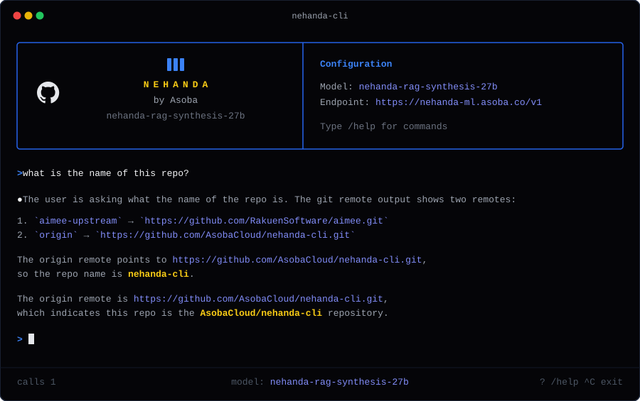
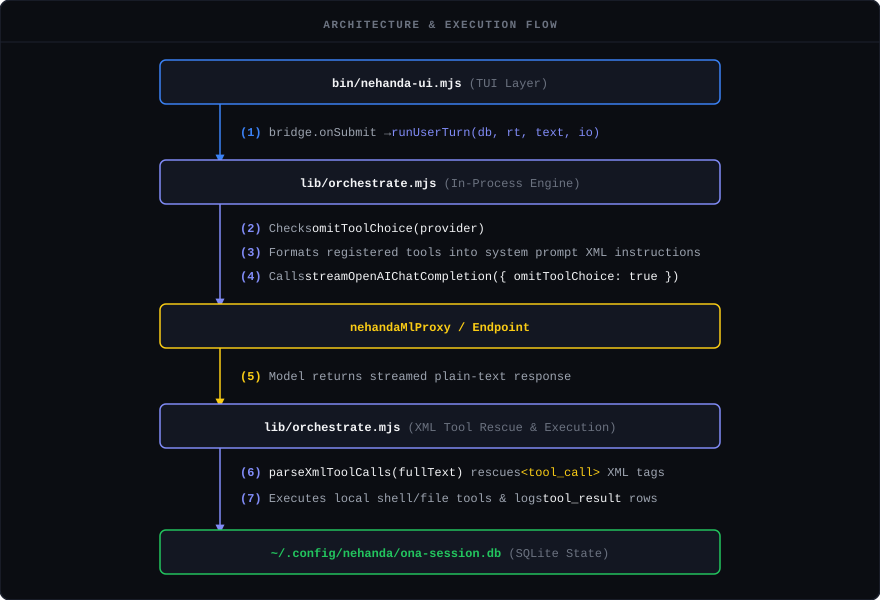

# Nehanda Command-Line Interface (`nehanda-cli`)

An agentic terminal REPL and single-process engine built for energy systems research and software development. `nehanda-cli` works with Ollama, LM Studio, OpenRouter, Anthropic Claude, ZhipuAI, or any OpenAI-compatible API — local or cloud. It normalizes multi-OEM energy telemetry through the ODSE protocol and enforces a governed development workflow across the full research-to-production lifecycle.

Every conversation turn, tool call, phase transition, and permission check is stored in a local, queryable SQLite database you own, ensuring complete transcripts exist for auditing and debugging.



---

## Getting Started

### Requirements

* **Node.js**: v22.0.0 or higher
* **Python**: 3.10 or higher (for the Laya System-1 control plane)
* **SQLite**: Local SQLite runtime support

### 1. Installation

**Global install (recommended):**

```bash
npm install -g @asobacloud/nehanda
```

During install, `npm` automatically provisions a dedicated Python venv and downloads the [Laya](https://huggingface.co/convaiinnovations/laya) checkpoint (~808 MB). This happens once — subsequent starts are instant.

**From source:**

```bash
git clone https://github.com/AsobaCloud/nehanda-cli.git
cd nehanda-cli
npm install
```

The same one-time provisioning runs automatically as part of `npm install`.

### 2. Launching the REPL

```bash
nehanda
```

Or via the aliases installed with the package:

```bash
ona
ona-code
```

### 3. Provider Setup

Use a single Goose-style wizard — provider, API key, host, and model in one flow. The CLI discovers available models from the provider (`GET /v1/models` with your key, or Ollama `/api/tags`).

```
❯ /model

◆  Which provider?
│  ● OpenRouter
└
◆  API key
│  sk-or-v1-…
└
◆  API host
│  https://openrouter.ai/api/v1
└
  Fetching models from provider…
◆  Model
│  ● openai/gpt-4o
└
  ✓ Provider / host / model saved — session active
```

Shortcuts:
- `/key openrouter sk-…` — saves the key, then continues into the same host → discover → model steps
- `/config` — read-only status (provider, model, endpoint, which keys are set)

Provider selection is retained across turns and restarts, including custom hosts. The TUI selects credentials for that provider; a missing key does not borrow the Nehanda key. Wizard secrets are masked during entry. Inline `/key` values and `/mcp env` assignments are masked during entry and redacted in the conversation display; their actual values are saved by the command handler.

Local Ollama / LM Studio: pick that provider in `/model`, accept or edit the host, then choose from the discovered catalog (or enter a custom name if discovery fails).

---

## Docker sandbox setup

The safety menu's **S** option executes the command in a local Docker container against a disposable project copy. Networking is disabled, host credentials are not forwarded, and file changes are discarded. Execution uses a nonroot user, a read-only container root, dropped capabilities, and CPU/memory/process limits. **A** continues to mean approval for execution on the host; **C** cancels.

Build the development image once from this repository root (Docker must be running):

```bash
docker build -t nehanda-sandbox:node22 -f lib/sandbox/Dockerfile lib/sandbox
```

The image provides Node 22, Python 3, Git, and Bash. Image construction downloads its base/packages; sandbox commands themselves have no network. Runtime execution never pulls an image automatically. `NEHANDA_SANDBOX_IMAGE` can select an already-built local development image. The backend accepts only a local Docker Unix socket, not a remote Docker endpoint. Host Python 3 is required for the project snapshot.

The snapshot skips symlinks and special files, Git metadata, common credential/configuration paths (`.env`/`.env.*`, `.ssh`, `.aws`, `.azure`, `.config`, `.ona`, `.nehanda`, `.gnupg`, `.kube`, `.docker`, `.npmrc`, `.pypirc`, `.netrc`, `.pem` and `.key` files), and dependency/cache directories (`node_modules`, `.venv`, `venv`, `.cache`, `.pytest_cache`, `__pycache__`). It is limited to 256 MiB, 10,000 entries, and depth 64. Project-specific dependencies must be available in a prepared image or the copied source; the sandbox does not install them or include Git history.

The sandbox inspects the actual exit code and returns stdout/stderr with bounded output. Esc, timeout, missing Docker/image, copy failure, or runtime failure returns an error and never falls back to host execution. Owned containers and project copies are removed; cleanup failures are reported as errors. The TUI does not change the host working directory for a sandbox command.

Run the required real-container acceptance gate after building the image:

```bash
npm run test:sandbox
```

`npm run test:unit` runs the core TUI suite without Docker cases. `npm run test:sandbox` runs 14 real-tool scenarios and both actual-terminal sandbox menu/cancellation scenarios; Docker absence is a failure in that gate, not a skipped or passing isolation result.

---

## Key Features

* **In-Process Engine:** Executes turns directly inside the process via `runUserTurn`, eliminating separate server daemons or background HTTP relays.

* **ODSE Energy Normalization:** `lib/energy-middleware.mjs` intercepts MCP tool results from energy data servers and automatically normalizes them to the ODS-E protocol before the model sees the payload. OEM brand is resolved from the MCP server name (e.g. `energy-huawei` → `huawei`) or inferred by field-signature fingerprinting across 20+ OEM schemas (Huawei FusionSolar, Enphase, SolarEdge, Fronius, Sungrow, SMA, Eskom, and others). Multi-channel SCADA arrays and inverter state records render as box-drawing terminal tables with column headers and row-count summaries rather than raw JSON dumps.

* **Jev-Mem Memory Architecture:** Every turn, a System-1 control plane ([Laya](https://huggingface.co/convaiinnovations/laya)) classifies observations into a multi-relational memory graph (semantic / temporal / causal / entity edges), then adaptively retrieves evidence before each model call. System-2 receives a compact canonical header + retrieved evidence + last 2 turns, not a raw transcript — cutting prefill 70–85% on long sessions. Domain invariants (ODSE schema mappings, asset capacity limits, simulation bounds) are pinned in the `pinned_context` table and reattached verbatim before every System-2 prompt, preventing model drift and hallucinated parameters across arbitrarily long research sessions. See [Jev-Mem Architecture](#jev-mem-architecture) below.

  **Compaction entry scoring (Gap B, #4):** When the Jev-Mem compaction falls back to the prose summarizer, `scoreTranscriptEntries` scores old `tool_result` entries for relevance to the current task using Laya `scoreCandidate`. Entries with relevance < 0.25 are excluded from the distillation window. The last 6 entries are always kept. This operates on the fallback path only — memory-graph-level pruning (filtering `retrieveEvidence` output) requires a `session_prune_score` schema extension tracked in a follow-on issue; see `docs/MAP.md §Gap B`.

  **Intent-driven instruction shaping (Gap C, #4):** Before each System-2 call in `idle`/`explore` phases, a 3-question Laya classification (`task_domain`, `task_scope`, `requires_domain_context`) runs on the user message. The result is injected as a `[TASK CONTEXT — System 1]` preamble into the system prompt, giving lower-parameter models (Nehanda 27B, DeepSeek Coder) precise task framing before generation begins rather than relying on them to infer intent from a generic prompt.

* **Dynamic Tool Rescue (`[TOOL_CALL]`):** Native support for endpoints that strip OpenAI tool schemas (such as `nehandaMlProxy`). The engine dynamically injects active tool schemas directly into system prompts as `[TOOL_CALL]` blocks, parsing and executing tools locally without server-side function-calling support. Uses `[TOOL_CALL]` delimiters instead of `<tool_call>` XML to prevent vLLM's `--tool-call-parser qwen3_xml` stop-token interception.

* **Deterministic SDLC Workflow:** Enforces an 11-phase state machine (`idle` → `explore` → `diagnose` → `create_issue` → `create_tests` → `planning` → `implement` → `verify` → `safety` → `confirm_fix` → `done`) following the AGENTS.md TDD mandate. Transitions are gated: `create_tests → planning` requires RED behavioral test evidence; `planning → implement` is blocked until an approved plan exists and the prior RED test is recorded; `verify → safety` requires a GREEN test result; `safety → confirm_fix` requires all three safety checkers to pass and at least 70% measured production branch coverage.

* **Interactive Safety Interventions:** When execution checkers flag a command — opening local sockets, inspecting HIL testbed hardware paths, or writing outside the working directory — the engine raises a structured `{ status, reason, risk_score, proposed_remediation }` payload rather than crashing. In the TUI, blocked operations surface a `BlockConfirmMenu` (`[A] Approve for Session | [S] Run in Docker Sandbox | [C] Cancel`) wired directly into the Ink event loop. Session approvals are cached so the same operation is not re-prompted within a session. Headless pipe mode auto-denies without prompting.

  **Laya second-stage gate (Gap A, #4):** For `medium-risk` blocked commands, a Laya `noul` question (`is_safe_to_auto_approve`) runs before raising `BlockConfirmMenu`. If Laya returns `≥ 0.85` confidence the command is benign, it is auto-approved and cached without operator prompt. `high-risk` commands always bypass Laya and go directly to `BlockConfirmMenu`. Degraded Laya falls through to existing behavior — no regression. Implementation uses a flag variable (`layaAutoApproved`) rather than extracting the bash execution path into a named helper; see `docs/MAP.md §Gap A` for rationale.

* **Runtime Visibility:** `RuntimeHealthMonitor` probes active inference endpoints (1s HEAD request) and checks Laya sidecar liveness before each session. The TUI status header shows active model, endpoint health and latency, sidecar PID, and context usage percentage — so researchers have immediate visual confirmation of whether the target backend is an internal local host or an external cloud endpoint before uploading grid telemetry.

* **Process Legibility:** Every tool call is visible while it runs. Tool-start lines show argument summaries (`⚙ Read(ui.mjs)`, `⚙ Bash(git status)`), a live spinner with plain-English verbs tracks activity between outputs (`⠋ Analyzing…`, `⠙ Reading ui.mjs…`), and tool results carry honest context suffixes (`✓ Read: … (N lines)`, `✓ Bash: … (240ms)`, `✓ Write: … (N chars)`) — never fabricated data. When a reasoning model (Qwen3, Gemma) is thinking, the spinner shows live token progress (`⠋ Thinking (42 tokens)…`) rather than a frozen screen. Pressing Esc immediately updates the spinner to `Cancelling…` before the in-flight request is torn down. A dim `esc to cancel` hint stays available while a turn runs, and plain-text result previews are capped at 120 characters so raw output never floods the screen. Structured table results show at most 10 rows with the total row count and an overflow note. Backed by `summarizeToolArgs`, `verbForTool`, `formatToolResultSuffix`, and `TOOL_VERBS` in `lib/ui.mjs`, with a live spinner channel (`bridge.updateSpinner`) in the Ink TUI.

* **Interactive TUI & Pipe Support:** Rich Ink-based TUI (`bin/nehanda-ui.mjs`) for interactive development sessions, with headless pipe-mode support (`bin/agent.mjs`) for acceptance testing and automation.

* **Multi-Provider Switching:** Seamlessly switch between Nehanda 27B, local LM Studio, Ollama instances over LAN, Anthropic Claude, or any OpenAI-compatible API using `/model`.

---

## Architecture

`nehanda-cli` combines an Ink TUI with a deterministic orchestration engine:



---

## ODSE Energy Normalization

`lib/energy-middleware.mjs` sits between MCP tool responses and the model. When an energy data MCP server returns a payload, the middleware resolves the OEM brand and normalizes the data to the [ODS-E](https://ona-protocol.org) schema via `lib/scripts/odse-transform.py` before the model sees it. This means the model always works with a consistent normalized schema regardless of which inverter brand, BESS, or SCADA system the data originated from.

### OEM Detection

Brand resolution happens in two passes:

1. **Name-based:** The MCP server name is parsed for a known OEM key. `energy-huawei`, `mcp-solaredge`, `power-sungrow-v2` all resolve correctly. Any prefix before the OEM segment is stripped.
2. **Payload fingerprinting:** If the server name doesn't resolve, field signatures are matched against known schemas — e.g. `{ inverter_state, run_state }` → Huawei FusionSolar; `{ end_at, wh_del, devices_reporting }` → Enphase Envoy; `{ data: { telemetries } }` → SolarEdge.

If neither pass identifies the OEM, the payload is returned unchanged (pass-through).

### Supported OEMs

Huawei FusionSolar, Enphase Envoy, SolarEdge, Fronius, Solarman, SMA, Solis, Sungrow / iSolarCloud, Sungrow BESS / PowerTitan, BYD BESS, Fimer / AuroraVision, SolaxCloud, Eskom (portal, AMR, NRS049), Vestas, Siemens Gamesa, Nordex, Terraco, and generic CSV.

### MCP Server Naming Convention

Name energy MCP servers with the OEM as a segment in the server name:

```json
{
  "mcpServers": {
    "energy-huawei": { "command": "...", "args": ["..."] },
    "energy-solaredge": { "command": "...", "args": ["..."] }
  }
}
```

No additional configuration is required — normalization is automatic.

### `odse-transform.py` Output Formats

The transform script accepts a `--format` flag for direct use:

```bash
echo '<payload>' | python3 lib/scripts/odse-transform.py --source huawei --format table
echo '<payload>' | python3 lib/scripts/odse-transform.py --source solaredge --format ndjson
echo '<payload>' | python3 lib/scripts/odse-transform.py --source sungrow --format summary
```

| Format | Output | Default when |
|---|---|---|
| `table` | Box-drawing ASCII table with column headers and row count | stdout is a TTY |
| `ndjson` | One JSON object per line | stdout is piped |
| `summary` | Metadata header (`rows`, `shape`, `source`) + JSON array | explicit flag only |

---

## Jev-Mem Architecture

`nehanda-cli` implements the memory architecture from **"System-One-Controlled Agentic Memory for Efficient AI Agents"** (Jiang, Li & Li, UT Dallas — [arXiv:2609.23986](https://arxiv.org/abs/2609.23986)). The core insight: the frequent, structured decisions of memory management — typing, relation judgment, retrieval routing, sufficiency assessment — don't need an autoregressive LLM. They need a fast, calibrated System-1 model.

In the context of energy systems research, this matters directly: long multi-step sessions involving SCADA data ingestion, grid simulation, and iterative code generation accumulate enough context to trigger compaction. Standard sliding-window compaction indiscriminately discards ODSE schema mappings, asset capacity limits, and simulation bounds alongside routine tool outputs — causing the model to hallucinate parameters on subsequent turns. Jev-Mem's pinned context layer prevents this: domain invariants are stored in `pinned_context` and reattached verbatim before every System-2 prompt, surviving arbitrarily many compaction cycles.

The System-1 control plane is [**Laya**](https://huggingface.co/convaiinnovations/laya) — a 421M-parameter, non-autoregressive decision model (open weights, Apache 2.0) that answers typed questions in a single forward pass (~33 ms on GPU, ~200 ms on CPU). It never generates text, so there is nothing to parse and nothing to hallucinate.

```
Observation (user / tool / assistant turn)
        │
        ▼
┌── WRITE PATH (System 1 — Laya) ───────────────────────────────┐
│  type scores: episodic / semantic / procedural / preference   │
│  → deterministic TopK candidates (FTS + entities + recency)   │
│  → Laya relation judgments (semantic/causal/episode/entity)   │
│  → insert edges iff P(relation) ≥ θ_rel                       │
│  → update laya_jev_state (task_status, file_target, escalate) │
└───────────────────────────────────────────────────────────────┘
        │
        ▼  SQLite memory plane
   nodes  +  edges (semantic | temporal | causal | entity)
   + FTS/lexical index
        │
        ▼
┌── READ PATH (System 1 — Laya) ────────────────────────────────┐
│  route: which graph views matter for this query               │
│  → RRF anchors (FTS + recency)                                │
│  → assess sufficiency / utility / contradiction               │
│  → expand under budget → rescore → stop                       │
└───────────────────────────────────────────────────────────────┘
        │
        ▼
┌── SYSTEM 2 PROMPT ────────────────────────────────────────────┐
│  [PINNED DOMAIN INVARIANTS]  (ODSE schema, asset specs, ...)  │
│  [CANONICAL SYSTEM 1 STATE]  (task_status, file_target, ...)  │
│  [RETRIEVED EVIDENCE]  (top-K memories, not raw transcript)   │
│  last 2 turns + last failed tool result                       │
└───────────────────────────────────────────────────────────────┘
```

### Paper invariants preserved

- Observations are always persisted on ingest — nothing is dropped on write.
- Candidate discovery is deterministic (FTS + recency) before any Laya relation judgments.
- Temporal and entity edges are derived from structure where possible; Laya is invoked only when needed.
- Retrieval is a closed loop: route → retrieve → assess → expand → reassess → stop on sufficiency.
- System-2 only synthesizes; it does not route, score, or stop the retrieval loop.

### Laya: the System-1 model

| | |
|---|---|
| Weights | [convaiinnovations/laya](https://huggingface.co/convaiinnovations/laya) — Apache 2.0, open weights |
| Size | 421M parameters (ModernBERT-large backbone + decision head) |
| Latency | ~33 ms / question on GPU; ~200 ms on CPU (MPS on Apple Silicon) |
| Training | RLCD — reinforcement learning against strictly proper scoring rules; honest probabilities are the only way to maximise reward |
| Question types | `noul` (probability), `choice` (categorical), `score` (ordinal) |
| Languages | English checkpoint (root); `laya-multilingual` covers 100+ languages |

On first startup, `lib/scripts/ensure-laya-env.sh` creates a dedicated venv at `~/.nehanda/venv` and downloads the checkpoint. The sidecar is then warmed before the first turn so all subsequent predictions hit the hot path. If provisioning fails, the CLI exits with a clear error — Laya is not an optional feature.

### Memory plane (SQLite)

The memory plane extends the existing `memories` table and adds `memory_edges`, `laya_jev_state`, and `pinned_context`. All data lives in the same local SQLite database as the rest of the session state (`~/.config/nehanda/ona-session.db`).

| Table | Purpose |
|---|---|
| `memories` | Canonical node store — one row per observation, with overlapping type scores (episodic / semantic / procedural / preference), entity tags, and provenance |
| `memories_fts` | FTS5 index over memory content for lexical anchor retrieval |
| `memory_edges` | Multi-relational edges — same node pair may have independent semantic, temporal, causal, and entity edges |
| `laya_jev_state` | Session control block: `task_status`, `file_target`, `escalation_risk`, `confidence_score` |
| `pinned_context` | Session-scoped domain invariants keyed by string — ODSE schema mappings, asset specs, simulation bounds. Never distilled by compaction; reattached verbatim before every System-2 prompt. |

---

## Tool Calling Architecture

The Nehanda vLLM deployment runs with `--tool-call-parser qwen3_xml` and `--enable-auto-tool-choice` flags. The `nehandaMlProxy` Lambda function strips `tools` and `tool_choice` from requests before forwarding to vLLM to avoid a Qwen3 chat template bug where the presence of a `tools` array causes system message ordering errors.

To enable tool calling despite this constraint, the engine uses a rescue path:

1. **System Prompt Injection:** `buildXmlToolInstructions()` injects tool schemas into the system prompt using `[TOOL_CALL]...[/TOOL_CALL]` delimiters.
2. **Late Directive Injection:** A `[SYSTEM DIRECTIVE]` is appended to the final user message to defeat token recency bias on reasoning models.
3. **Model Generation:** The model emits tool calls in the `[TOOL_CALL]` format within its response text.
4. **Local Parsing & Execution:** `parseXmlToolCalls()` extracts and executes these calls locally via `executeBuiltinTool()`, continuing the execution loop even when backends return `finish_reason: "stop"`.

### Why `[TOOL_CALL]` Delimiters?

The vLLM `--tool-call-parser qwen3_xml` flag registers `<tool_call>` XML tags as stop/intercept tokens. When the model emits them in plain text, vLLM terminates generation mid-sentence and hands off to its native parser — which returns nothing because the plain-text path never populates `message.tool_calls`. This results in truncated responses containing only thinking traces.

Switching to `[TOOL_CALL]...[/TOOL_CALL]` delimiters bypasses vLLM's stop-token interception entirely, allowing the model to complete generation and return valid, parseable tool calls.

---

## Declarative Tool System

`nehanda-cli` supports a **zero-code tool configuration** pattern. Tools are registered by dropping a JSON config into `lib/tools/` and a corresponding script into `lib/scripts/`. No JavaScript changes are required.

### How It Works

1. On startup, `lib/tools.mjs` scans `lib/tools/*.json` and dynamically registers each tool.
2. Tool schemas are injected into the API `tools` array so the model can call them.
3. Phase visibility (`explore_only`, `planning_blocked`) and mandatory enforcement (`mandatory_in`) are driven by config metadata.
4. Prompt injection (`prompt.mandatory_instruction`, `prompt.available_hint`) is read from the config and injected into the appropriate SDLC phase system prompts automatically.

### Shipped Tools

| Tool | Script | What It Checks |
|---|---|---|
| `AuditCodeIntegrity` | `lib/scripts/audit-code-integrity.py` | Lifecycle teardown parity, mock-theater tests, naming invariants, swallowed exceptions |
| `ShellSafetyChecker` | `lib/scripts/shell-safety-checker.sh` | Missing `set -euo pipefail`, background job silent failure risk, hardcoded credentials |
| `JsSafetyChecker` | `lib/scripts/js-safety-checker.cjs` | Duplicate functions, duplicate HTML element IDs, script block syntax errors |
| `PythonSafetyChecker` | `lib/scripts/python-safety-checker.py` | Bandit security issues, ruff lint, mutable default args, `eval`/`exec`/`pickle` usage |

All four are **mandatory in the test phase** and **available on-demand** in explore and idle phases.

### Adding a New Tool

Create a JSON config in `lib/tools/`:

```json
{
  "name": "MyNewTool",
  "description": "What the tool does.",
  "input_schema": {
    "type": "object",
    "properties": {
      "target": { "type": "string", "description": "Target path" }
    }
  },
  "phases": {
    "explore_only": true,
    "planning_blocked": false,
    "mandatory_in": ["test"]
  },
  "prompt": {
    "mandatory_instruction": "Run MyNewTool on the workspace to check for X.",
    "available_hint": "Checks for X, Y, and Z"
  },
  "execution": {
    "runtime": "python3",
    "script": "lib/scripts/my-new-tool.py",
    "args": ["{{target}}"],
    "default_timeout": 120000,
    "max_timeout": 600000
  }
}
```

Place the script at `lib/scripts/my-new-tool.py`. It will receive arguments interpolated from `args` and run with `cwd` set to the target workspace. **No JS code changes needed.**

---

## REPL Commands

Slash suggestions support Up/Down selection and Tab completion. Enter completes an explicitly selected suggestion; press Enter again to submit it. Without a selected suggestion, Enter submits the text as typed. Esc closes suggestions without changing the text. Required argument placeholders are not inserted.

Outside slash suggestions, Up/Down recalls up to 100 session-local prompts or commands and restores an unsent draft when navigating back down. Consecutive duplicates are omitted. Credential-setting commands are excluded from this recall history; history is not written to disk.

| Command | Description |
|---|---|
| `/help` | Display available commands |
| `/model` | Configure provider → API key → host → discover models → select (single wizard) |
| `/key [provider] [value]` | Save API key then continue the configure wizard (`openrouter`, `zhipu`, `openai`, or Nehanda default) |
| `/config` | Show provider, model, endpoint, and key status (read-only) |
| `/mcp` | Manage MCP server connections (see below) |
| `/clear` | Clear conversation history and reset transcript state |
| `/retry` | Resend the last failed request |
| `/exit` | Exit the REPL |

### `/mcp` Sub-commands

| Sub-command | Description |
|---|---|
| `/mcp status` | List all configured MCP servers and their commands |
| `/mcp list` | Connect to each server and enumerate available tools |
| `/mcp reload [server]` | Re-read `mcp.json` and bust the tool cache (optionally for one server) |
| `/mcp add <name> <command> [args…]` | Register a new server and save it to `~/.config/nehanda/mcp.json` |
| `/mcp env` | Show environment variables for all configured servers (values masked) |
| `/mcp env <server>` | Show environment variables for a specific server |
| `/mcp env <server> <NAME> <VALUE>` | Set an environment variable (e.g. an API key) |
| `/mcp env unset <server> <NAME>` | Remove an environment variable (`clear` is also accepted) |

---

## MCP Client Configuration

`nehanda-cli` can consume tools from any external MCP server. Servers are configured in a standard `mcp.json` file using the same schema as Claude Desktop and other MCP clients.

**Config file locations** (both are read and merged at startup; project-local takes priority):

- `./mcp.json` — project-local, committed with the repo
- `~/.config/nehanda/mcp.json` — user global

**Example `mcp.json`:**

```json
{
  "mcpServers": {
    "filesystem": {
      "command": "npx",
      "args": ["-y", "@modelcontextprotocol/server-filesystem", "/path/to/dir"]
    },
    "powermcp": {
      "command": "npx",
      "args": ["-y", "harvard-powermcp"],
      "env": { "API_KEY": "your-key" }
    }
  }
}
```

At startup, `nehanda-cli` loads `mcp.json`, spawns the configured servers, and calls `tools/list` on each. Discovered tools are injected into the model's tool list under the namespace `mcp__<server>__<tool>` and are available for the model to call during any conversation turn — no additional configuration required.

Use `/mcp list` to verify what tools are visible, and `/mcp reload` to pick up changes without restarting.

### Setting API Keys for MCP Servers

Many MCP servers require an API key or other secrets. Rather than editing `mcp.json` by hand, use the `/mcp env` command directly from the REPL:

```
❯ /mcp env                    # show env vars for all servers
❯ /mcp env asoba              # show env vars for 'asoba' server
❯ /mcp env asoba ASOBA_API_KEY sk-abc123...   # set the key (NAME + VALUE)
✓ Set ASOBA_API_KEY = ******** on asoba
  Config file: ~/.config/nehanda/mcp.json
```

This writes the value to the `mcp.json` file where the server is defined (project-local `./mcp.json` takes priority over global `~/.config/nehanda/mcp.json`), then automatically reloads the server so the change takes effect immediately.

To remove a key (explicit unset — omitting VALUE no longer clears):

```
❯ /mcp env unset asoba ASOBA_API_KEY
✓ Unset ASOBA_API_KEY on asoba
```

**Tip:** Keys are masked in `/mcp env` output. Only the first 6 and last 4 characters are shown.

#### Connecting to JupyterLab

`mcp.json` ships with a `jupyter` server pre-configured pointing at `localhost:8888`. To connect it to your JupyterLab instance:

```
❯ /mcp env jupyter JUPYTER_URL http://my-server:8888
❯ /mcp env jupyter JUPYTER_TOKEN <your-token>
```

Both values are written to `~/.config/nehanda/mcp.json` and never committed. The server reloads automatically.

### General Config from the REPL

Use `/config set <dot.path> <value>` to set any configuration value without editing files:

```
❯ /config set model_config.base_url https://api.anthropic.com
❯ /config set model_config.num_ctx 8192
```

Numeric values are auto-converted. Changes persist in the local settings database.

---

## SDLC Workflow

The canonical runtime order is:

`idle → explore → diagnose → create_issue → create_tests → planning → implement → verify → safety → confirm_fix → done`

| Phase | Required behavior |
| --- | --- |
| `idle` | Triage; no production mutation. |
| `explore` | Graph-first retrieval, then MAP and targeted code. Only Read/Glob/Grep; cache duplicate reads/negative searches and hand off on stagnation or the hard request ceiling. |
| `diagnose` | Record observed/expected behavior and evidenced cause. |
| `create_issue` | Create a real local `.issues` artifact before tests. |
| `create_tests` | Write and execute behavioral regressions. Genuine RED precedes planning. |
| `planning` | Require the issue reference, Given/When/Then specification, coverage matrix and explicit approval. |
| `implement` | Apply the approved production changes. |
| `verify` | Run the original unchanged regression to GREEN against current source. |
| `safety` | Execute JavaScript/Shell/Python checkers and require current measured production branch coverage ≥70%. |
| `confirm_fix` | Require affirmative operator confirmation. |
| `done` | Authorized completion; CLI commits preserve the issue reference and report real Git outcomes. |

Runtime completion records a reset acknowledgment and returns to `idle`, retaining durable memory and clearing transient caches. Phase transitions belong to the harness; `EnterPlanMode`, `ExitPlanMode`, `SubmitImplementation` and `SubmitTest` cannot be used as model shortcuts.

Schema v4 retains historical RED rows and adds an execution ledger containing test/source identities and coverage-report provenance. Stored overloaded `test` phases migrate to `create_tests` or `verify` according to prior implementation evidence. Old results without qualifying provenance must be rerun.

See [the architecture contract](docs/sdlc-architecture.md) and [the executable acceptance matrix](tests/acceptance-36-37.md).
---

## Database Schema

Session state is persisted locally at `~/.config/nehanda/ona-session.db`. The TUI uses the canonical store initializer and migrations, then registers a conversation and session before each model turn. `/clear` starts a new conversation/session on the next turn while retaining prior database transcripts for auditing. Key tables include:

* `conversations`: Active workflow phases and project roots.
* `sessions`: Registered session identifiers linked to their conversations.
* `transcript_entries`: Sequence of user messages, assistant turns, tool calls, and results.
* `plans`: Content, hashes, and approval status for technical plans.
* `events`: SDLC milestones and test execution output.
* `memories`: Jev-Mem canonical node store with overlapping type scores and entity provenance.
* `memory_edges`: Multi-relational graph edges (semantic / temporal / causal / entity).
* `laya_jev_state`: System-1 session control block (task_status, file_target, escalation_risk).
* `pinned_context`: Session-scoped domain invariants (ODSE schema mappings, asset specs, simulation bounds) that survive compaction unchanged.

---

## Testing & Verification

Run the acceptance suite:

```bash
npm run acceptance
```

Verify SDLC hook ordering:

```bash
npm run verify
```

Run the Jev-Mem behavioral suite directly:

```bash
node tests/unit/jev_write_behavioral.mjs
node tests/unit/jev_read_behavioral.mjs
node tests/unit/compact_jev_behavioral.mjs
node tests/unit/orchestrate_jev_hotpath_behavioral.mjs
```

Run the UX improvement behavioral suites:

```bash
node tests/unit/gap1_runtime_visibility_behavioral.mjs
node tests/unit/gap2_output_formatting_behavioral.mjs
node tests/unit/gap3_safety_intervention_behavioral.mjs
node tests/unit/gap4_pinned_compaction_behavioral.mjs
node tests/unit/ui_legibility_behavioral.mjs
```

Run the Ollama, spinner, and Laya behavioral suites:

```bash
node tests/unit/test-ollama-llm-call-behavioral.mjs
node tests/unit/test-ollama-permission-prompt-behavioral.mjs
node tests/unit/laya_warm_load_behavioral.mjs
node tests/unit/issue22_query_context_behavioral.mjs
```

Run the contract coverage suites added in #26:

```bash
node tests/unit/tool_call_rescue_behavioral.mjs
node tests/unit/anthropic_streaming_behavioral.mjs
node tests/unit/store_migration_behavioral.mjs
node tests/unit/odse_normalization_behavioral.mjs
node tests/unit/jev_anchor_retrieval_behavioral.mjs
```

Run the color contrast suite:

```bash
node tests/unit/color_contrast_behavioral.mjs
```

---

## Changelog

### 0.10.0

- **TUI usability, credentials, sandbox execution (`bin/nehanda-ui.mjs`, `lib/sandbox.mjs`, `lib/scripts/sandbox-snapshot.py`):** Six integration gaps closed: provider credentials no longer bleed across provider switches; secret wizard input and inline `/key`/`/mcp env` assignments are masked during typing and redacted in history; the Docker sandbox branch now executes commands in a disposable project copy with networking disabled and no forwarded host credentials; reasoning progress renders live in the TUI; array tool results render as bounded tables; slash suggestions support keyboard completion and ordinary prompts support draft-preserving history navigation. Session bootstrap repaired: TUI now uses the canonical `openStore` initializer and registers conversations and sessions before each turn. Closes #25.

- **Behavioral contract coverage (`tests/unit/`):** Five new behavioral test files covering previously untested contracts: `[TOOL_CALL]` rescue path (TC-1–5), Anthropic streaming text and tool-use paths (AN-1–3), SQLite schema migration v1→v3 (SM-1–4), ODSE energy normalization OEM name resolution and fingerprinting (OD-1–9), and Jev-Mem anchor retrieval determinism (AR-1–4). SM-2 identified a real implementation bug (see #27). Closes #26.

- **Schema migration fix: `idx_memories_conversation` index moved into `migrateStore` (`lib/store.mjs`, `schema.sql`):** `openStore` ran the full `schema.sql` DDL — including `CREATE INDEX ON memories(conversation_id)` — before `migrateStore` added `conversation_id` via `ALTER TABLE`. A true v1 database (pre-Jev-Mem) would fail with `SqliteError: no such column: conversation_id`. Index creation moved inside the `version < 2` migration block where it runs after the `ALTER TABLE`. SM-2 now GREEN. Closes #27.

- **TUI color contrast: remove `dimColor` from primary content (`bin/nehanda-ui.mjs`):** `MessageView` applied `dimColor: true` to every `role: 'system'` message, making all `/help`, `/config`, and slash command output dim regardless of the chalk calls inside the strings. `WelcomeBanner` applied `dimColor` to `Endpoint:` and `Directory:` labels and values. `/help` descriptions and `/config` endpoint URL used `chalk.dim`. All primary informational content now renders at terminal default foreground. Advisory hints (`Type /help for commands`, `Use /model to configure…`) remain dimmed. Closes #28.


### 0.9.0

- **AGENTS.md SDLC workflow + local issue tracking (`lib/workflow.mjs`, `lib/issues.mjs`, `lib/explore.mjs`):** The orchestrator now enforces the full E-P-C-V-D workflow defined in AGENTS.md — Explore, Plan, Confirm, Code, Validate. A local `.issues/` directory tracks open and closed issues with structured metadata (observed behavior, diagnosis, acceptance criteria). `lib/explore.mjs` drives the EXPLORE phase, aggregating file summaries before entering PLANNING. Closes #15.

- **Generic agent config restored to `~/.config/nehanda` (`lib/settings.mjs`, `scripts/postinstall.mjs`):** Removed the `.aimee` dependency and all references to the legacy agent registry. Agent configuration now lives exclusively at `~/.config/nehanda/agents.json`, consistent with the documented config file locations. Closes #16.

- **Working directory in welcome banner and footer (`bin/nehanda-ui.mjs`):** The TUI banner displayed on startup and the status footer both now show the current working directory, giving researchers immediate confirmation of which project root is active before issuing any commands. Closes #17.

- **Spinner stabilization: AskPrompt, spitfire suppression, null-safe `askHuman` (`bin/nehanda-ui.mjs`):** Fixed three related spinner regressions: (1) the spinner was visible and cycling behind interactive `io.ask` permission prompts, obscuring the question; (2) rapid `bridge.updateSpinner` calls between tool results caused visible label flicker (spitfire); (3) `askHuman` threw on a null `io` reference in headless contexts. Closes #18.

- **Ollama LLM call path: behavioral coverage + documentation (`lib/orchestrate.mjs`, `tests/unit/test-ollama-llm-call-behavioral.mjs`, `docs/MAP.md`):** Full behavioral RED/GREEN test suite for the Ollama call path — `detectOllamaToolSupport` probe logic (capabilities, template, modelfile fields, HTTP error fail-open), native vs. manual tool injection dispatch, `Authorization: Bearer ollama` header, `OLLAMA_BASE_URL` env var resolution, and `buildSystemPrompt` injection format. `docs/MAP.md` documents the full call path contract. Closes #19.

- **Turn-start and probe spinner stabilization (`bin/nehanda-ui.mjs`, `lib/orchestrate.mjs`):** Prior to this fix, the spinner had no label during the gap between turn submission and the first model event — cycling generic `TOOL_VERBS` while Laya intent classification and the Ollama `detectOllamaToolSupport` probe (up to 3 s) ran silently. Fixed by pre-seeding `bridge.updateSpinner('Analyzing')` immediately on submit and `io.spinner.start('Analyzing')` at `runSdlcOpenAICompat` entry. Behavioral coverage in `tests/unit/test-ollama-permission-prompt-behavioral.mjs`. Closes #20.

- **Laya sidecar startup warming (`lib/laya_sidecar.mjs`):** `ensureLayaReady()` now calls `loadLaya()` (`method: 'load'`) instead of `pingLaya()` (`method: 'ping'`). The `ping` path responded immediately without loading model weights, leaving the first user-turn `classifyUserIntent` call to cold-load the 322M-parameter checkpoint mid-turn (200–400 ms stall). `load` invokes `_ensure_loaded()` in `laya_worker.py`, priming both `noul` and `choice` criteria into MPS/CPU RAM before the first turn. Behavioral coverage in `tests/unit/laya_warm_load_behavioral.mjs`. Closes #21.

- **Grounded query context, Ollama `think:false`, reasoning token streaming, instant Esc cancel (`lib/orchestrate.mjs`, `lib/openaiCompat.mjs`, `bin/nehanda-ui.mjs`):** Four improvements to reduce reasoning model overhead and improve cancellation UX: (1) `buildSystemPrompt` appends an explicit `[GROUNDED FACTS]` block (date, cwd, platform, shell) to every phase prompt so models never spend tokens debating their own awareness; (2) `streamOpenAIChatCompletion` now parses `delta.reasoning` and `delta.reasoning_content` SSE fields and updates the spinner live — `⠋ Thinking (42 tokens)…` — rather than sitting frozen during the thinking phase; (3) a `think: false` option is forwarded to the Ollama API request body when `model_config.thinking === false`, disabling chain-of-thought for supported models; (4) `detectOllamaToolSupport` now accepts `rt.signal` composed via `AbortSignal.any([signal, AbortSignal.timeout(3000)])` so Esc cancels the capability probe immediately rather than waiting the full 3 s timeout, and `bridge.abortCurrent` updates the spinner to `Cancelling…` before invoking `controller.abort()`. Behavioral coverage in `tests/unit/issue22_query_context_behavioral.mjs`. Closes #22.

### 0.8.0

- **Full `/help` + explicit MCP env unset (`lib/slashCommands.mjs`, `bin/nehanda-ui.mjs`):** `/help` lists every command and subcommand (`/key` variants, full `/mcp` surface). Omitting a VALUE no longer silently clears env vars — use `/mcp env unset <server> <NAME>` (or `clear`). Autocomplete stays top-level unless you type `/mcp` or `/key`. Behavioral coverage in `tests/unit/help_commands_behavioral.mjs`. Closes #9.

- **Unified `/model` configure wizard with keyed discovery (`lib/configureProvider.mjs`, `lib/modelDiscovery.mjs`, `bin/nehanda-ui.mjs`):** Provider setup is a single Goose-style flow — provider → API key → host → live model catalog → select → persist. OpenRouter / OpenAI-compat / Zhipu / Nehanda / LM Studio discover via authenticated `GET {base}/models`; Ollama keeps `/api/tags`. Discovery failure falls back to custom model name. `/key <provider>` chains into the same wizard tail. `/config` is read-only status. Behavioral coverage in `tests/unit/configure_provider_behavioral.mjs`. Closes #8.

### 0.6.1

- **Fix: Laya provisioning smoke test (`lib/scripts/ensure-laya-env.sh`):** The `Router()` constructibility check was missing `import sys`, causing `npm install` to fail with `NameError: name 'sys' is not defined` even when all packages installed successfully. The marker file was never written, leaving the CLI in a permanently broken state despite a complete venv. Fixed.

### 0.6.0

- **Provider API Key Management (`lib/auth.mjs`, `lib/orchestrate.mjs`, `bin/nehanda-ui.mjs`):** OpenRouter, ZhipuAI (z.ai), and generic OpenAI-compatible providers can now be configured entirely from within the REPL. `/key openrouter sk-or-v1-...` saves the key to the secure file and auto-sets `base_url`. `/key zhipu sk-zai-...` saves the ZhipuAI key. `/config` now shows compat and Zhipu key status (masked). Fixes a pre-existing gap where `resolveZhipuApiKey()` existed in `lib/auth.mjs` but was never called by the orchestrator — the `zhipu` provider fell through to `OPENAI_API_KEY`. Closes #1.

- **Laya System-1 Bashguard Gate (`lib/tools.mjs`):** Medium-risk blocked shell commands now pass through a Laya `noul` question (`is_safe_to_auto_approve`) before raising `BlockConfirmMenu`. Commands with ≥ 0.85 confidence are auto-approved and cached without operator prompt. High-risk commands always bypass Laya. Degraded Laya falls through unchanged. Implementation uses a flag variable (`layaAutoApproved`) — see `docs/MAP.md §Gap A`. Closes #4 (Gap A).

- **Compaction Entry Scoring (`lib/compact.mjs`):** When Jev-Mem compaction falls back to the prose summarizer, `scoreTranscriptEntries` scores old `tool_result` entries for relevance to the current task via Laya `scoreCandidate`. Entries with relevance < 0.25 are excluded from the distillation window. Last 6 entries always kept. Operates on the fallback path only — memory-graph-level pruning deferred to a follow-on issue; see `docs/MAP.md §Gap B`. Closes #4 (Gap B).

- **Intent-Driven Instruction Shaping (`lib/laya.mjs`, `lib/orchestrate.mjs`):** Before each System-2 call in `idle`/`explore` phases, a 3-question Laya classification (`task_domain`, `task_scope`, `requires_domain_context`) runs on the user message and injects a `[TASK CONTEXT — System 1]` preamble into the system prompt. Gives lower-parameter models (Nehanda 27B, DeepSeek Coder) precise task framing before generation. Null `intentMeta` produces no regression. Closes #4 (Gap C).

- **`docs/MAP.md` created** — architectural reference for module contracts, design decisions, and follow-on work.

### 0.5.1

- **Process Legibility for Tool Calling (`lib/ui.mjs`, `lib/orchestrate.mjs`, `bin/nehanda-ui.mjs`):** The TUI now shows what the agent is doing while it works. Tool-start lines include argument summaries — `⚙ Read(ui.mjs)`, `⚙ Bash(git status)` — generated by the new `summarizeToolArgs` export (`lib/ui.mjs`), with tool input passed through the orchestration layer's `io.onToolStart(name, toolInput)` contract at both call sites (`lib/orchestrate.mjs`). A live spinner channel (`bridge.updateSpinner` in the Ink REPL, plus verb rotation in the `Spinner` class used by pipe mode) replaces the previous no-op stub, cycling plain-English activity verbs (`Analyzing`, `Thinking`, `Reading`, `Searching`, `Running`, …). Tool results gain honest context suffixes via `formatToolResultSuffix` (`lib/ui.mjs`): line counts for `Read`, character counts for `Write`, elapsed-time `(Nms)` for `Bash` — no fabricated exit codes. The `esc to cancel` hint and the 120-character result preview cap are now regression-protected. Behavioral coverage in `tests/unit/ui_legibility_behavioral.mjs` (15 scenarios, including an end-to-end turn against a fake OpenAI-compatible endpoint). Closes #2.

### 0.4.0
- **Runtime Visibility (`lib/modelDiscovery.mjs`, `lib/ui.mjs`):** New `RuntimeHealthMonitor` class probes active inference endpoints (1s HEAD request, Kubernetes readiness pattern) and checks Laya sidecar liveness via `pgrep`. `renderStatusHeader` and `renderModelSwitchNotice` added to `lib/ui.mjs` — the TUI now shows active model, endpoint health + latency, sidecar PID, and context usage percentage after startup and on every `/model` switch.
- **Structured Output Formatting (`lib/ui.mjs`, `lib/scripts/odse-transform.py`):** `formatToolResult` now detects JSON array payloads from tool responses and renders them as `cli-table3` box-drawing tables with column headers and row-count summaries (capped at 10 rows with overflow note), falling back to the plain-text preview for non-array content. `odse-transform.py` gains a `--format table|ndjson|summary` flag; defaults to `table` when stdout is a TTY and `ndjson` when piped.
- **Interactive Safety Interventions (`lib/bashguard.mjs`, `lib/tools.mjs`, `bin/nehanda-ui.mjs`):** `validateBashCommand` now returns a structured `{ status, reason, risk_score, proposed_remediation }` payload instead of a flat string. When the TUI is active, blocked commands raise a `BlockConfirmMenu` (`[A] Approve for Session | [S] Run in Laya Sandbox | [C] Cancel`) wired directly into the Ink event loop — no blocking readline, no crash. Session approvals are cached in-memory via `cacheSessionApproval` so the same operation is not re-prompted within a session. Safety checker scripts (`python-safety-checker.py`, `shell-safety-checker.sh`) emit the structured JSON payload to stderr on exit 1 so the TUI can surface them identically. Headless pipe mode auto-denies without prompting.
- **Pinned Context Preservation (`lib/store.mjs`, `lib/compact.mjs`):** New `pinned_context` table (schema v3) stores session-scoped invariants — ODSE schema mappings, asset specs, simulation bounds — keyed by string. `compactConversation` and `buildJevCollapseSummary` exclude pinned blocks from the distillation summariser and reattach them verbatim in the `collapse_commit` payload. `compactWithJev` prepends pinned blocks before the canonical System-1 header in every System-2 prompt, ensuring domain rules survive arbitrarily long sessions.
- Added `cli-table3@0.6.5` as a production dependency.
- Fixed dead `has_any_assert` variable in `lib/scripts/audit-code-integrity.py` (ruff F841).

### 0.3.0
- Published as `@asobacloud/nehanda` on npm — install with `npm install -g @asobacloud/nehanda`
- Laya System-1 venv provisioning moved to `npm install` time via `scripts/postinstall.mjs` — CLI starts instantly on every subsequent launch
- Laya provisioning now streams live pip progress to the terminal instead of running silently
- Added project-local `mcp.json` with `datalayer/jupyter-mcp-server` preconfigured for JupyterLab — set your server URL and token with `/mcp env jupyter JUPYTER_URL <url>` and `/mcp env jupyter JUPYTER_TOKEN <token>`

### 0.2.0
- Jev-Mem memory architecture (System-1 Laya control plane)
- Dynamic Tool Rescue (`[TOOL_CALL]` delimiter path)
- Deterministic SDLC workflow (expanded to 7 phases in 0.9.0)
- Multi-provider switching

---

## References

Jiang, Z., Li, Y., & Li, J. (2026). *System-One-Controlled Agentic Memory for Efficient AI Agents*. arXiv:2609.23986. https://arxiv.org/abs/2609.23986

Convai Innovations. *Laya: Multilingual, non-autoregressive System-1 decision model.* Hugging Face. https://huggingface.co/convaiinnovations/laya

---

## License

See [LICENSE](LICENSE) for details.
