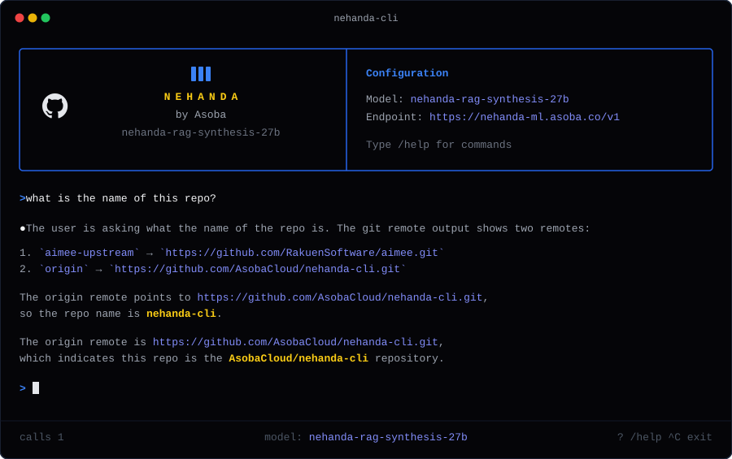

# Nehanda Command-Line Interface (`nehanda-cli`)

An agentic terminal REPL and single-process engine built for energy systems research and governed software development. `nehanda-cli` connects to local and cloud models (Ollama, LM Studio, OpenRouter, Anthropic Claude, ZhipuAI, OpenAI-compatible APIs), normalizes multi-OEM energy telemetry through the ODSE protocol, and enforces a deterministic, verifiable SDLC across the entire research-to-production lifecycle.

Every turn, tool call, phase transition, and safety check is persisted in a local, queryable SQLite database you own.



> 📖 **Full Documentation & Architectural Reference**: For exhaustive guides on Jev-Mem, Laya System-1, ODSE energy normalization, MCP servers, sandboxing, and schema contracts, visit the official documentation portal:
> 👉 **[https://code.asoba.co/nehanda-cli](https://code.asoba.co/nehanda-cli)**

---

## First 5 Minutes: Quickstart

### Prerequisites

* **Node.js**: `v22.0.0` or higher
* **Python**: `3.10` or higher (powers the Laya System-1 control plane)
* **SQLite**: Local SQLite runtime support

---

### 1. Download & Installation

Choose your preferred installation method:

**Global npm install (Recommended):**

```bash
npm install -g @asobacloud/nehanda
```
During installation, `npm` automatically provisions a dedicated Python virtual environment and downloads the [Laya](https://huggingface.co/convaiinnovations/laya) checkpoint (~808 MB) once — subsequent startups are instant.

**Single-line curl installer:**

```bash
curl -fsSL https://asoba.co/releases/install.sh | sh
```
The installer downloads `nehanda-cli-latest.tar.gz` and automatically validates its SHA-256 digest against `SHA256SUMS` before unpacking into `~/.nehanda`. Prebuilt distribution artifacts (`.tar.gz`, `.bin`, `.dmg`) and cryptographic checksums are hosted at:
👉 [https://asoba.co/releases/SHA256SUMS](https://asoba.co/releases/SHA256SUMS)

**From source:**

```bash
git clone https://github.com/AsobaCloud/nehanda-cli.git
cd nehanda-cli
npm install
```

**Launch the REPL:**

```bash
nehanda
# or use the bundled aliases: ona, ona-code
```

---

### 2. BYOK (Bring Your Own Key) & Provider Setup

Nehanda is fully model-agnostic. Bring your own keys for cloud providers or connect directly to local inference backends. Run the interactive `/model` wizard:

```
❯ /model

◆  Which provider?
│  ● OpenRouter
└
◆  API key
│  sk-or-v1-… (input masked)
└
◆  API host
│  https://openrouter.ai/api/v1
└
  Fetching models from provider…
◆  Model
│  ● openai/gpt-4o
└
  ✓ Provider / host / model saved — session active
```

**Quick configuration shortcuts:**
* `/key openrouter sk-or-v1-...` — save provider API key and immediately discover models.
* `/key zhipu sk-zai-...` — configure ZhipuAI (GLM) backend.
* `/config` — view current provider, active model, endpoint latency, and masked key status.
* Local models (Ollama, LM Studio): select local provider in `/model`, accept default host (`http://localhost:11434`), and select from your downloaded models.

---

### 3. Work the SDLC in 5 Minutes

Nehanda enforces an **11-phase governed development lifecycle** that ensures every code change is backed by an issue, proven with behavioral tests, and validated through safety checkers before commit:

$$\text{idle} \rightarrow \text{explore} \rightarrow \text{diagnose} \rightarrow \text{create\_issue} \rightarrow \text{create\_tests} \rightarrow \text{planning} \rightarrow \text{implement} \rightarrow \text{verify} \rightarrow \text{safety} \rightarrow \text{confirm\_fix} \rightarrow \text{done}$$

Here is how you complete a full governed cycle in 5 minutes:

1. **Start with a task (`idle → explore`)**:
   Type your requirement or bug description:
   ```text
   ❯ Fix: energy-huawei tool fails when inverter state is missing run_state
   ```
   Nehanda initiates graph-first retrieval, reads target code with duplicate caching, and inspects repository architecture.

2. **Diagnose with evidence (`diagnose`)**:
   Nehanda evaluates observed vs. expected behavior with dual citations (code symbol + doc contract), identifying the root cause without speculative guesses.

3. **Track local issue (`create_issue`)**:
   Nehanda creates a structured local issue artifact in `.issues/` capturing the diagnosis, root cause, and concrete acceptance criteria.

4. **Author behavioral tests first (`create_tests`)**:
   In strict adherence to TDD, behavioral tests (`*_behavioral.py` or `*.mjs`) are authored and executed against current code. They must fail (**RED**) for the diagnosed defect before proceeding.

5. **Review & approve technical plan (`planning`)**:
   Nehanda presents a line-accurate plan specifying exact files, diffs, and risk mitigations. Review and approve the plan (`/plan approve`) to authorize code modifications.

6. **Implement & verify GREEN (`implement → verify`)**:
   Nehanda applies the approved surgical changes and immediately re-executes the regression suite to confirm tests pass (**GREEN**).

7. **Pass safety checkers & finalize (`safety → confirm_fix → done`)**:
   Automated safety checkers (JavaScript syntax/duplicates, Shell script hazards, Python bandit/lint) run alongside production branch coverage checks ($\ge 70\%$). Once confirmed, Nehanda creates a clean Git commit referencing the issue (`fix: description (#issue)`).

---

## Deeper Dive: Documentation Portal

For detailed architectural references, configuration manuals, and API contracts, explore the official documentation:

* 🌐 **[Documentation Home](https://code.asoba.co/nehanda-cli)**
* 🧠 **[Jev-Mem System-1 & Laya](https://code.asoba.co/nehanda-cli)**: 421M non-autoregressive decision model, multi-relational memory graph, and pinned domain invariants.
* ⚡ **[ODSE Energy Normalization](https://code.asoba.co/nehanda-cli)**: Automatic OEM fingerprinting (Huawei, Enphase, SolarEdge, Sungrow, SMA) and SCADA table formatting.
* 🛡️ **[OS-Primitives Sandboxing](https://code.asoba.co/nehanda-cli)**: Zero-container isolated execution using macOS Seatbelt (`sandbox-exec`) and Linux Bubblewrap (`bwrap`).
* 🔌 **[MCP Servers & Declarative Tools](https://code.asoba.co/nehanda-cli)**: Zero-code tool registry (`lib/tools/`), `mcp.json` client configuration, and JupyterLab connectivity.
* 🗄️ **[Database Schema & Auditing](https://code.asoba.co/nehanda-cli)**: SQLite session persistence, transcript auditability, and queryable memory planes.
* 🛠️ **[Dynamic Tool Rescue (`[TOOL_CALL]`)](https://code.asoba.co/nehanda-cli)**: Stop-token bypass for endpoints stripping OpenAI tool schemas.

---

## Verification & Testing

Run the test suites locally to verify runtime integrity:

```bash
npm run acceptance     # Run full SDLC acceptance suite
npm run test:unit      # Run behavioral unit test suite
npm run test:sandbox   # Run OS-primitives sandbox test suite
npm run verify         # Verify SDLC hook execution order
```

---

## License

Published under the [Apache-2.0 License](LICENSE).
